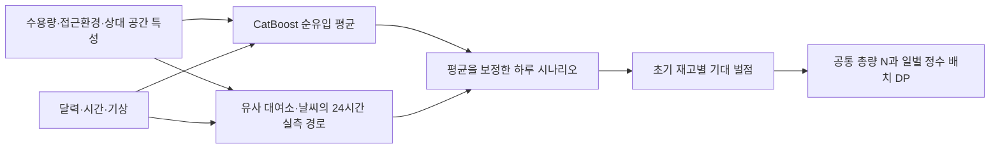

# CatBoost · 하루 수요 시나리오 · 정수 배치 최적화

이 구현은 시간별 `반납 - 대여`를 예측하고, 원문 대회의 실제 목적함수로 자전거 배치까지 결정한다. 실제로 비교한 후보 중 내부 검증 벌점이 가장 낮은 방법을 선택했다. 가능한 모든 머신러닝 방법 중 최적임을 보장하는 결과는 아니다.

## 문제에 맞춘 설계

B에는 과거 대여·반납 실적이 없다. A에서 학습한 대여소 ID나 해당 대여소의 과거 수요를 B의 입력으로 사용할 수 없으므로, 접근환경·수용량·달력·기상과 지역 내 상대적인 공간 특성을 이용한다. A/B의 좌표계가 각각 변환되어 있으므로 절대 x,y는 학습 변수에서 제외하고, 정규화한 중심 거리와 인근 대여소 거리·환경 요약을 사용한다.

A는 대여소 176곳 × 30일 × 24시간 = 126,720행이며, B는 159곳 × 30일 × 24시간 = 114,480행이다. 제공된 두 엑셀의 시간별 수요(A만), 대여소, 거리, 접근환경, 달력·기상 시트를 사용했다. 추가 외부 수요 데이터는 사용하지 않았다. B의 한 달 기상 입력이 주어지는 대회 조건에 따라 일별 기상 요약도 입력한다.



CatBoost의 정답은 `returns - rentals`이며 손실은 RMSE다. 트리 깊이 4/6, 최대 400회, 학습률 0.05, L2=20, 조기 종료 35회, seed=202606을 사용한다. 입력 처리와 학습 API는 [CatBoost 공식 문서](https://catboost.ai/docs/en/concepts/python-reference_catboostregressor_fit)를 기준으로 구현했다.

조건이 비슷한 A 대여소 32곳과 같은 휴일 유형의 유사 기상일 3일에서 총 96개의 24시간 경로를 만든다. 수용량 비율의 제곱근으로 경로 규모를 조정하고, 유사도 가중치를 부여한다. 한 경로의 24시간 전체를 함께 사용하므로 시간 간 수요 변동의 연결이 유지된다. 지역 간 연결망의 동일성이나 대여소 간 수요 보존을 가정하지 않는다.

평균 예측만 사용하는 방식(point), 실측 유사 경로(analog), 평균을 절반 보정한 경로(blend), 평균을 CatBoost 예측에 맞춘 경로(centered)를 비교했다. 최종 선택은 **centered, 깊이 6, 트리 277개**다. 전체 A로 최종 학습했다.

## 배치 목적함수

초기 배치 x와 시간별 순유입 y에 대해 `z=b+y`, `u=max(-z,0)`, `o=max(z-capacity,0)`, `b=clip(z,0,capacity)`, `e=max(b-floor(capacity/2),0)`를 계산한다.

최소화하는 대회 벌점은 `20*N + 일평균 Σ(6*u² + 5*o + e)`다. 부족 위험의 비대칭성은 이 실제 벌점에서 반영한다. 이전 모델의 임의적인 과대예측 3배 손실과는 별도로, 이번 평균 예측 자체는 대칭 RMSE로 학습한다.

모든 대여소의 가능한 정수 초기 재고에 대해 시나리오 평균 벌점을 계산한다. 각 날짜·총량 N별 최소 벌점을 동적 계획법으로 구한 뒤, 모든 날짜에 공통으로 적용할 양의 정수 N을 선택한다. DP는 팀 저장소의 `code/3_DemandToOut.py` 방식을 바탕으로 구현했다. 이 최적해는 **추정한 시나리오 비용에 대한 최적해**다. B의 실제 수요에 대한 최적해를 의미하지 않는다.

## A 검증 결과

대여소를 외부 5분할하여 평가 대여소의 수요 실적을 전부 제외하고, 나머지 대여소의 6월 1~23일로 학습하여 평가 대여소의 24~30일을 예측했다. 전체 176곳이 한 번씩 평가되며 총 29,568행이다. 각 외부 학습 집합 안에서 다시 대여소를 3분할하고 1~16일 학습, 17~23일 선택을 수행했다. 최종 설정 선택에는 24~30일 외부 평가 정답을 사용하지 않는다. 한 도시 안의 검증이므로 실제 도시 간 전이 성능은 별도로 확인할 수 없다.

| 방법 | 순유입 MAE | 순유입 RMSE | 실제 일평균 대회 벌점(낮을수록 좋음) |
|---|---:|---:|---:|
| 내부 검증으로 선택한 파이프라인 | 2.6499 | 5.0402 | 274,359.714 |
| CatBoost 평균 예측으로만 배치 | 2.6761 | 5.2033 | 277,932.714 |
| 대여소당 매일 1대 | — | — | 279,890.714 |
| 매일 수용량 절반(내림) | — | — | 279,999.286 |
| 순유입을 항상 0으로 예측 | 2.7165 | 5.7760 | — |

배치 벌점은 평균 예측 배치보다 1.29%, 1대 기준보다 1.98% 낮았다. 개선은 제한적이고, 외부 5번째 분할에서는 평균 예측 배치가 더 좋았다. 선택 파이프라인은 4개 분할에서 centered, 1개 분할에서 point를 선택했다. 표는 이 선택 절차 전체의 평가다. 각 분할에서 별도로 구한 총량·배치를 합쳐 전체 A의 합법적인 배치표로 평가했다. 이 배치의 N은 841이고, 최종 B 모델의 N과 다르다.

순유입 MAE 2.6499는 대여소·시간당 절대오차 평균이다. 정확도 97% 같은 백분율로 해석하면 안 된다. A 정답·예측을 `A_검증예측.csv`에, 평가 배치를 `A_검증배치.csv`에, 모든 후보·분할 지표를 `A_validation.json`에 저장했다.

## B 결과와 파일 사용

- `B지역_시간별_순유입_예측.csv`: 114,480행. 열은 `date,hour,station_id,pred_net_flow`. 양수는 재고 증가, 음수는 재고 감소. 소수 넷째 자리까지 저장했다.
- `B지역_추천배치표.csv`: 159행, `station_id,D01,...,D30`. 매일 총량 **N=565**. 모든 배치가 0 이상 정수이며 수용량 이하이다. 공식 `check_submission.py` 통과.
- `net_mean.cbm`, `reference.npz`, `model.json`: 재예측에 함께 필요한 세 파일. reference에는 유사 경로용 A 자료가 들어 있다.
- `B_summary.json`: 시나리오 기반 추정 비용과 기본 정보. 여기에 적힌 비용은 B의 실제 채점 결과가 아니다.

추천 배치표는 96개의 수요 시나리오를 반영한다. 시간별 평균 CSV만 기존 최적화 코드에 넣으면 수요 변동 정보가 빠지므로 이 추천 배치표와 달라질 수 있다. 이 방법의 배치 성능을 사용하려면 제공한 추천 배치표 또는 같은 시나리오 최적화 함수를 사용한다.

B에는 정답이 없어 예측 정확도나 실제 대회 벌점을 계산할 수 없다. N=565는 이 모델이 권하는 값이며 실측으로 검증된 최적 총량은 아니다.

## 저장소에서 실행

Python 3.12 CPU 환경에서 검증했다. 저장소 루트에서 실행하며 기존 `learn_data/`와 `input_data/`의 CSV 파일을 읽는다.

```sh
python -m pip install -r code/demand_decision/requirements.txt
python code/demand_decision/forecast_decision.py train
python code/demand_decision/forecast_decision.py predict
```

train은 교차검증·최종 학습·B 예측과 추천 배치를 함께 생성한다. predict는 기존 모델로 재예측한다. 기본 출력은 `code/demand_decision/results/`다. 별도 제공받은 `net_mean.cbm`, `reference.npz`, `model.json`을 모두 이 폴더에 넣으면 재학습 없이 predict를 실행할 수 있다.

```sh
python code/demand_decision/forecast_decision.py train --output-dir code/demand_decision/runs/experiment
python code/demand_decision/forecast_decision.py predict --output-dir code/demand_decision/runs/experiment
```

원본 엑셀용 코드의 별도 version2 사본이다. 입력 로더와 기본 입출력 경로만 바꿨으며, 학습·후보 선택·시나리오·최적화 함수는 원본과 동일하다. 엑셀/CSV 입력 처리 후 A/B의 모든 배열이 정확히 같고, 같은 학습 모델로 만든 B CSV 두 개와 B_summary.json의 SHA256도 같음을 확인했다.

저장소 루트 `.gitignore`가 이 모듈의 `results/`와 `runs/` 전체를 제외한다. CSV, JSON, CBM, NPZ, PT 등 실행 결과는 커밋하지 않는다. 기존 데이터와 다른 모델·최적화 코드는 변경하지 않는다. 작은 문제의 DP 결과를 완전탐색과 비교했고, A 평가 배치의 벌점을 공식 `score.py`로 대조했으며 B 제출표는 공식 형식 검사를 통과했다.
